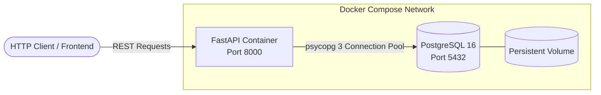
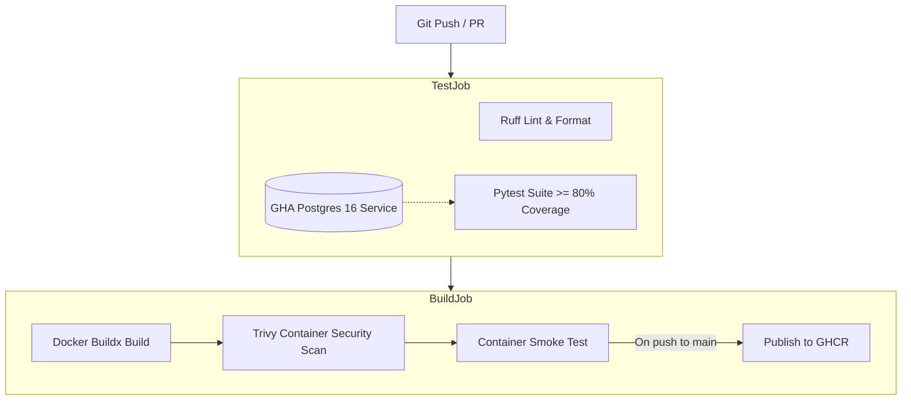

# Order Management API - DevOps CI/CD Pipeline

A containerized FastAPI application backed by PostgreSQL 16, featuring automated CI/CD code quality validation, database integration testing, container vulnerability scanning with Trivy, and automated publishing to GitHub Container Registry (GHCR).

---

## 1. Architecture Overview



### CI/CD Workflow Architecture



---

## 2. Technology Stack

- **Operating System**: Linux / WSL2
- **Language**: Python 3.12
- **API Framework**: FastAPI
- **Database**: PostgreSQL 16
- **Database Driver**: psycopg 3 (with `psycopg_pool`)
- **Package Manager**: `uv`
- **Testing**: `pytest`, `httpx`, `pytest-cov`
- **Linting & Formatting**: `Ruff`
- **Containerization**: Docker & Docker Compose
- **Security Scanner**: Trivy
- **CI/CD Platform**: GitHub Actions
- **Container Registry**: GitHub Container Registry (GHCR)

---

## 3. Endpoints

| Method | Endpoint | Description | Status Code |
| :--- | :--- | :--- | :--- |
| `GET` | `/` | Application metadata and status | `200 OK` |
| `GET` | `/health` | Application & database connectivity health | `200 OK` / `503 Unavailable` |
| `POST` | `/orders` | Create an order with validation | `201 Created` / `422 Unprocessable` |
| `GET` | `/orders` | List all orders | `200 OK` |
| `GET` | `/orders/{id}` | Retrieve a single order by ID | `200 OK` / `404 Not Found` |

### Order Data Schema

```json
{
  "id": 1,
  "customer_name": "Alice Smith",
  "item_name": "Mechanical Keyboard",
  "quantity": 2,
  "created_at": "2026-10-10T03:30:00Z"
}
```

---

## 4. Local Developer Workflow

### Prerequisites
- Python 3.12
- [`uv`](https://docs.astral.sh/uv/) installed
- Docker & Docker Compose

### Step 1: Clone and Configure Environment
```bash
git clone https://github.com/<your-username>/devops-cicd-pipeline.git
cd devops-cicd-pipeline
cp .env.example .env
```

### Step 2: Install Locked Dependencies
```bash
uv sync --locked
```

### Step 3: Start PostgreSQL via Docker Compose
```bash
docker compose -f docker-compose.app.yml up -d db
```

### Step 4: Run Linting and Tests
```bash
# Code style and formatting checks
uv run ruff check .
uv run ruff format --check .

# Run test suite with coverage
uv run pytest --cov=app --cov-report=term-missing --cov-fail-under=80 -v
```

### Step 5: Run the Full Application via Docker Compose
```bash
docker compose -f docker-compose.app.yml up --build
```

---

## 5. Testing with `curl`

```bash
# 1. Root info
curl -s http://localhost:8000/

# 2. Health check
curl -s http://localhost:8000/health

# 3. Create an order
curl -s -X POST http://localhost:8000/orders \
  -H "Content-Type: application/json" \
  -d '{"customer_name": "Alice", "item_name": "Laptop Stand", "quantity": 1}'

# 4. List all orders
curl -s http://localhost:8000/orders

# 5. Retrieve order by ID
curl -s http://localhost:8000/orders/1
```

